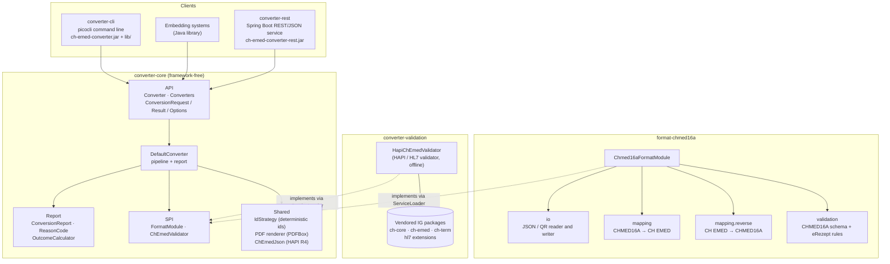
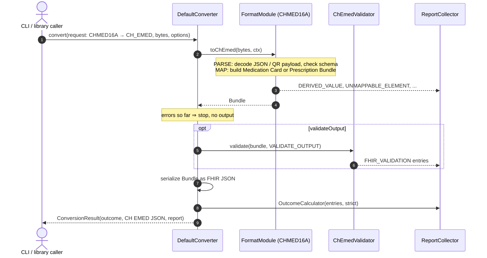
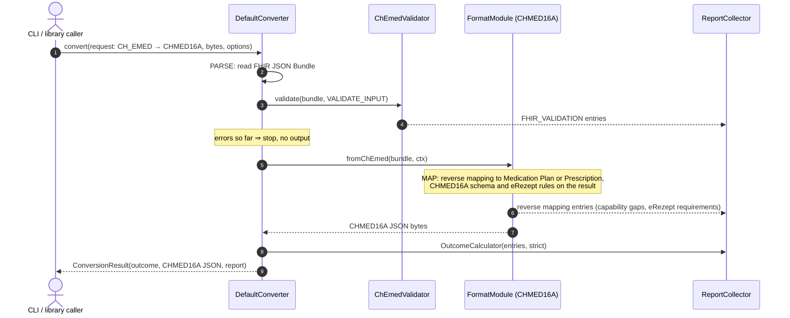
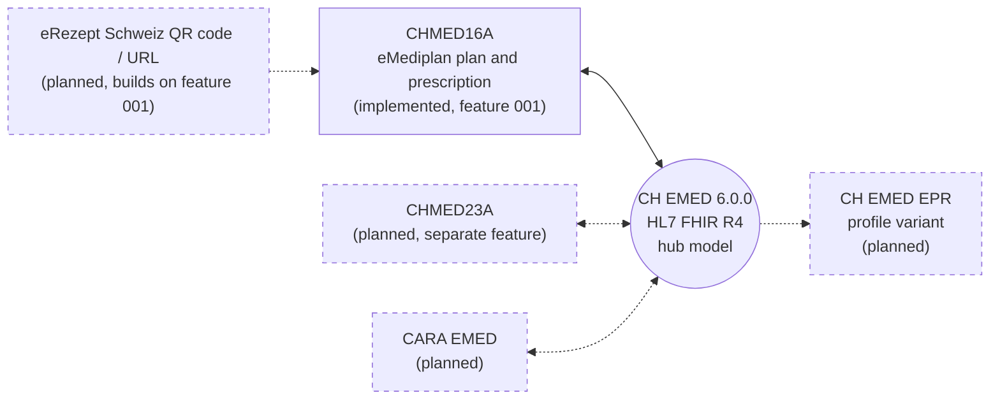

# Architecture

Overview of the CH EMED converter. The diagrams are [Mermaid](https://mermaid.js.org/) and render
on GitHub and in most Markdown viewers. Contracts: `specs/001-chmed16a-ch-emed-conversion/contracts/`,
mapping rules: [mapping/chmed16a-ch-emed.md](mapping/chmed16a-ch-emed.md).

## Principles

- **CH EMED (FHIR R4) is the hub.** Every external format converts to and from CH EMED; formats never
  convert directly into each other.
- **Core knows no format.** `converter-core` defines the API, the report and two SPIs; formats and
  the validator are plugged in with `ServiceLoader`.
- **Framework-free and offline.** No web or application framework, no network call at runtime
  (enforced by the Maven enforcer rules); the CH EMED packages are vendored.
- **Nothing is dropped silently.** Every loss, default or derived value ends up in the
  `ConversionReport`; `--strict` turns clinical loss into a failure.

## Modules

Dependencies in the POMs: `format-chmed16a` and `converter-validation` depend on `converter-core`;
`converter-cli` depends on all three (the format module at runtime). `converter-rest` depends on
`converter-core` and, at runtime, on the format and validation modules; it is the only module with
Spring dependencies (Spring Boot BOM imported in its own POM, enforced by the parent's
`enforce-framework-free` rule for all other modules). `converter-core` depends on neither.
Operation of the service: [operations/rest-service.md](operations/rest-service.md).

## Conversion pipeline

`DefaultConverter` runs one pipeline for both directions; every step can add entries to the report.
CH EMED is always one end of a conversion, the other end is a format module (here CHMED16A). The two
directions are shown separately.

### Format → CH EMED (e.g. CHMED16A → CH EMED)

### CH EMED → Format (e.g. CH EMED → CHMED16A)

The outcome is `SUCCESS`, `SUCCESS_WITH_WARNINGS` or `FAILED`; no output is returned for `FAILED`.
With `strict`, clinical loss turns the outcome into `FAILED`. Reports carry paths and codes only,
never patient values (privacy, see README "Logging (privacy)").

## Formats and extensions: implemented and planned

CH EMED is the hub; each format is a `FormatModule` of its own. Conversions between two non-CH-EMED
formats, if ever offered, are composed through CH EMED (constitution, "hub model"). Items marked
*planned* are not implemented; they are named in the constitution and in the feature specs, the
scope and timing are not decided yet.

| Item | Status | Notes |
|---|---|---|
| CHMED16A ↔ CH EMED | implemented (feature 001) | medication plan (MedType 1) and prescription (MedType 3); the prescription output is eRezept-ready |
| REST service | implemented (feature 002) | plain REST/JSON API on top of `converter-core` (`converter-rest`); documents base64-encoded, same options as the CLI; no access control or TLS in the service |
| CHMED23A ↔ CH EMED | planned | separate, later feature; CHMED23A was withdrawn by IG eMediplan but stays in the constitution's scope |
| CARA EMED | planned | named in the constitution as a format whose official examples join the test corpus |
| eRezept QR code / URL | planned | QR images, QR payload creation and signed eRezept URLs (`https://eprescription.hin.ch/#CHMED16A1…`); feature 001 only decodes the textual `CHMED16A1…` payload |
| CH EMED EPR | planned | feature 001 targets the general CH EMED IG; the EPR variant would be a separate feature |

Out of scope for now: the CHMED16A PolymedicationCheck document type.

## Adding a format

1. New module `format-<name>` that depends on `converter-core`.
2. Implement `FormatModule` (`toChEmed`, `fromChEmed`, `pinnedSpecification`) and register it in
   `META-INF/services/ch.emed.converter.core.spi.FormatModule`.
3. Document the rules in `docs/mapping/` and pin the specification version.
4. Put the module on the classpath of the client (CLI, REST service, embedding application);
   `Converters.create()` discovers it.

No change to `converter-core` is needed.
