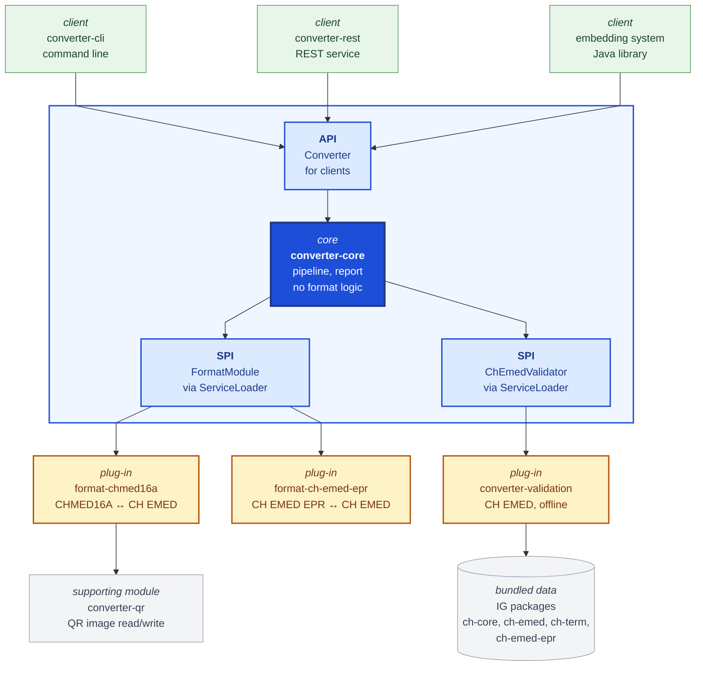
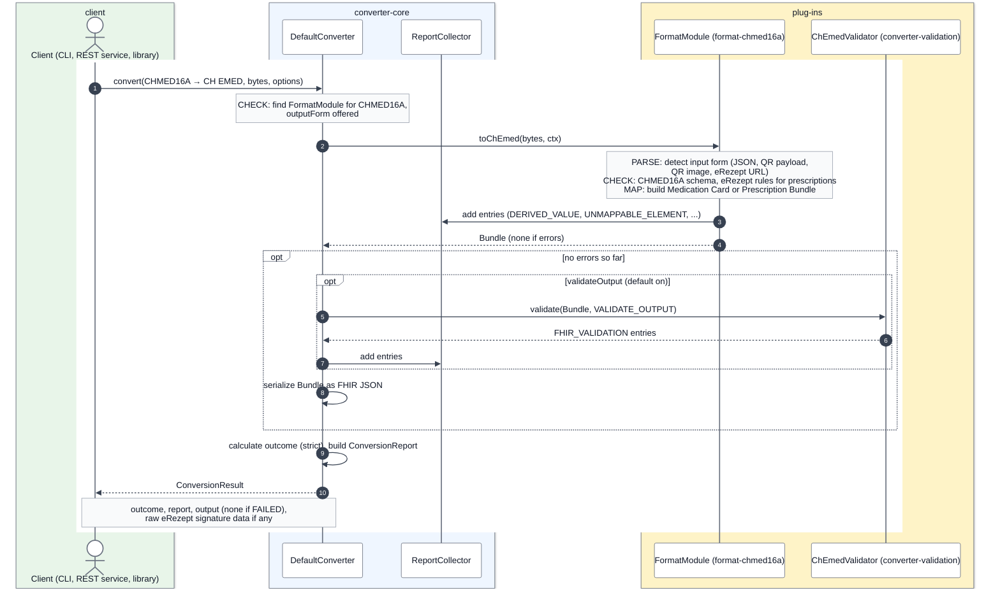
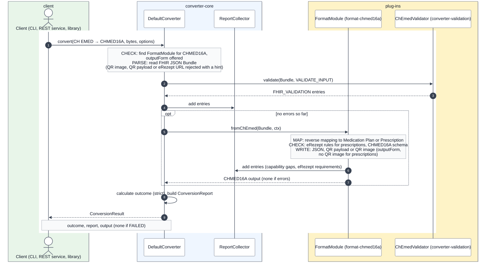
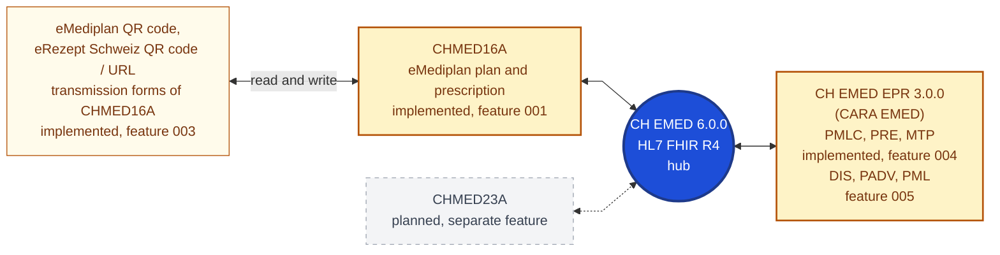

# Architecture

Overview of the CH EMED converter. The diagrams are [Mermaid](https://mermaid.js.org/) and render
on GitHub and in most Markdown viewers. Contracts: `specs/001-chmed16a-ch-emed-conversion/contracts/`,
mapping rules: [mapping/chmed16a-ch-emed.md](mapping/chmed16a-ch-emed.md).

## Principles

- **CH EMED (FHIR R4) is the hub.** Every external format converts to and from CH EMED; formats never
  convert directly into each other.
- **Core knows no format.** `converter-core` defines the API, the report and two SPIs; formats and
  the validator are plugged in with `ServiceLoader`.
- **Framework-free and offline.** No web or application framework, no network call at runtime
  (enforced by the Maven enforcer rules); the CH EMED packages are vendored.
- **Nothing is dropped silently.** Every loss, default or derived value ends up in the
  `ConversionReport`; `--strict` turns clinical loss into a failure.

## Modules

### Build dependencies

The diagram above shows who calls whom at runtime. The build dependencies in the POMs point
the other way: the plug-ins depend on `converter-core` because they implement its SPIs, while
`converter-core` depends on no other module of the project. This is why a new format can be
added without changing the core.

| Module | Depends on (project modules) | Notes |
|---|---|---|
| `converter-core` | none | HAPI FHIR structures, PDFBox |
| `converter-qr` | none | ZXing only |
| `format-chmed16a` | `converter-core`, `converter-qr` | QR images and eRezept URLs (feature 003) |
| `format-ch-emed-epr` | `converter-core` | validates through the validator of the mapping context and renders the PDF/A with `converter-core` |
| `converter-validation` | `converter-core` | HAPI FHIR validator, vendored IG packages |
| `converter-cli` | `converter-core`, `converter-validation`; `format-chmed16a` and `format-ch-emed-epr` at runtime | picocli |
| `converter-rest` | `converter-core`; `format-chmed16a`, `format-ch-emed-epr` and `converter-validation` at runtime | only module with Spring (Spring Boot BOM in its own POM) |

"At runtime" means the module is only put on the classpath, where `ServiceLoader` finds it;
the client's code does not refer to it. All modules except `converter-rest` are kept free of
web and application frameworks by the parent POM's `enforce-framework-free` rule.
Operation of the REST service: [operations/rest-service.md](operations/rest-service.md).

## Conversion pipeline

`DefaultConverter` runs one pipeline for both directions; every step can add entries to the report.
CH EMED is always one end of a conversion, the other end is a format module (here CHMED16A). The two
directions are shown separately.

### Format → CH EMED (e.g. CHMED16A → CH EMED)

### CH EMED → Format (e.g. CH EMED → CHMED16A)

The outcome is `SUCCESS`, `SUCCESS_WITH_WARNINGS` or `FAILED`; no output is returned for `FAILED`.
With `strict`, clinical loss turns the outcome into `FAILED`. Reports carry paths and codes only,
never patient values (privacy, see README "Logging (privacy)").

The converter validates CH EMED input whenever a validator is available; the format module checks
its own input (for example the CHMED16A schema). CH EMED EPR input is always validated: without a
validator the conversion fails with `VALIDATION_INCOMPLETE` (feature 004, rule M-EPR-03). Output
validation is on by default and can only be switched off through the library API.

## Formats and extensions: implemented and planned

CH EMED is the hub; each format is a `FormatModule` of its own. Conversions between two non-CH-EMED
formats are not offered; the caller converts in two steps through CH EMED, and the converter names
that path when it refuses such a pair (constitution, "hub model"; feature 004 FR-004). Items marked
*planned* are not implemented; they are named in the constitution and in the feature specs, the
scope and timing are not decided yet.

| Item | Status | Notes |
|---|---|---|
| CHMED16A ↔ CH EMED | implemented (feature 001) | medication plan (MedType 1) and prescription (MedType 3); the prescription output is eRezept-ready |
| REST service | implemented (feature 002) | plain REST/JSON API on top of `converter-core` (`converter-rest`); documents base64-encoded, same options as the CLI; no access control or TLS in the service |
| CHMED23A ↔ CH EMED | planned | separate, later feature; CHMED23A was withdrawn by IG eMediplan but stays in the constitution's scope |
| eMediplan QR code, eRezept QR code / URL | implemented (feature 003) | transmission forms of CHMED16A, not formats of their own: QR images (PNG/JPEG) and signed eRezept URLs (`https://eprescription.hin.ch/#CHMED16A1…`) are read, the signature data is returned raw and unverified beside the document; QR payloads and, for medication plans, QR images are written (option `outputForm`); prescriptions only as unsigned payload for the HIN erxproxy |
| CH EMED EPR (CARA EMED) ↔ CH EMED | implemented (features 004, 005) | CH EMED EPR 3.0.0 of CARA, the EPR variant of CH EMED; there is no separate CARA format (constitution 1.5.0). Medication card (PMLC), prescription (PRE) and treatment plan (MTP) in both directions; output form `treatment-plans` makes one MTP per treatment of a card; unsupported elements are removed and reported, the original representation is a PDF/A. Since feature 005 also dispense (DIS), pharmaceutical advice (PADV) and medication list (PML) in both directions; references to other documents are checked within each document and full URLs become `urn:uuid`. Rules: [mapping/ch-emed-epr.md](mapping/ch-emed-epr.md). |

Out of scope for now: the CHMED16A PolymedicationCheck document type.

## Adding a format

1. New module `format-<name>` that depends on `converter-core`.
2. Implement `FormatModule` (`toChEmed`, `fromChEmed`, `pinnedSpecification`) and register it in
   `META-INF/services/ch.emed.converter.core.spi.FormatModule`.
3. Document the rules in `docs/mapping/` and pin the specification version.
4. Put the module on the classpath of the client (CLI, REST service, embedding application);
   `Converters.create()` discovers it.

No change to `converter-core` is needed.
